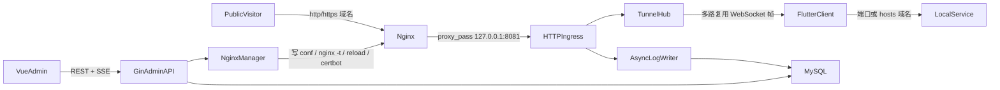
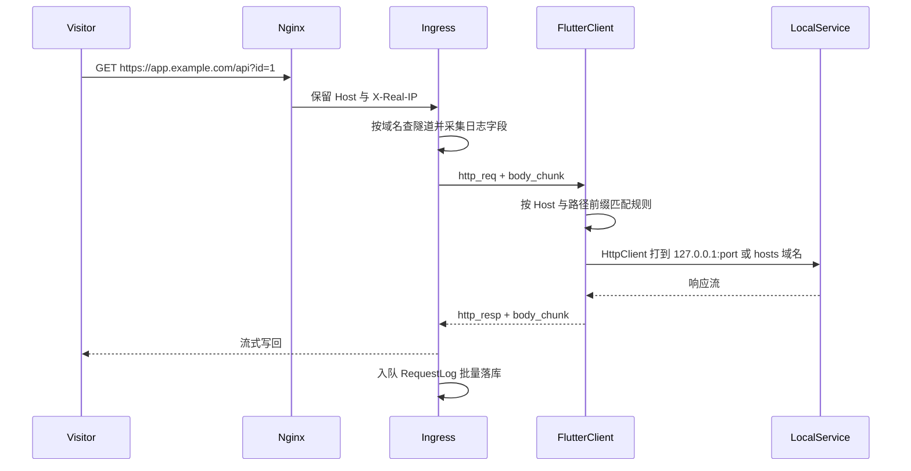

# 内网穿透工具：功能与技术实现

本文描述当前仓库已经落地的功能、数据流与关键实现细节，便于后续维护、部署和二次开发。快速上手仍以根目录 [README.md](README.md) 为准，生产部署步骤见 [deploy/README.md](deploy/README.md)。

---

## 1. 产品定位

把一台 Windows 内网机器上的 HTTP/HTTPS（含 WebSocket）服务，通过公网域名暴露出去。

典型路径：

1. 管理员在服务端后台创建一条「穿透记录」，得到接入地址和 Key。
2. Windows 客户端填入地址与 Key，测试连通性并保持长连接。
3. 客户端联通成功后，后台才能绑定公网域名。
4. 确定域名后，服务端自动生成 nginx 反代配置；勾选 HTTPS 时异步调用 certbot 申请 Let's Encrypt 证书。
5. 访客访问该域名 → nginx → 服务端入口 → 隧道 WebSocket → 客户端 → 本机端口或 hosts 中的虚拟域名。
6. 每个已绑定域名的公网请求都会写入详细日志（参数、Header、时间线、截断后的正文）；未绑定 Host 直接返回 404，不记录。

当前版本只做 HTTP 层穿透（含 WebSocket 升级透传），不做原始 TCP（MySQL、SSH、RDP 等）。

---

## 2. 仓库结构

```
内网穿透/
  server/     Go 1.23 服务端（Gin + Gorm + MySQL），go:embed 内嵌管理后台
  web/        Vite + Vue3 + TypeScript + Element Plus + Pinia
  client/     Flutter Windows 客户端
  deploy/     systemd、nginx 示例、sudoers、配置样例
  scripts/    build-server.ps1（交叉编译 linux/amd64）、build-client.ps1
```

分层约定：

- 后端：`handler` 只做校验与响应封装 → `service` 写业务规则 → `repository` 接口 + Gorm 实现 → `model` 表结构。
- 前端：`api/` 请求，`composables/` 复用逻辑，`views/*/components/` 展示，页面只负责编排。
- 客户端：`core/protocol` 帧编解码，`core/tunnel` 连接与重连，`core/forward` 本地转发，`services` 配置与 hosts，`pages` 界面。

---

## 3. 总体架构

服务端进程同时监听两个端口：

| 端口 | 绑定 | 用途 |
|------|------|------|
| `:8080` | 可对外 | 管理 API、内嵌 Vue 后台、客户端隧道 `/tunnel/ws` |
| `127.0.0.1:8081` | 仅本机 | 公网流量入口，只给 nginx `proxy_pass` |

在线会话保存在内存 `TunnelHub` 中（单实例）。每条穿透记录同一时刻只保留一个客户端；新连接会顶替旧连接，并记录原因 `replaced_by_new_client`。



---

## 4. 已实现功能

### 4.1 管理后台（Web）

- **登录**：用户名/密码，bcrypt 校验，JWT 会话（默认 72 小时）。登录页为左侧纯色品牌区 + 右侧表单。
- **修改密码**：右上角用户菜单 →「修改密码」，校验原密码，新密码 8~64 位且不能与原密码相同；成功后强制退出重新登录。原密码错误返回 400（不是 401），避免被拦截器误判为登录失效。
- **界面**：可折叠侧栏（状态存 localStorage）、顶栏显示当前页标题；设计变量集中在 `styles/tokens.css`，品牌色 `#3A6FF7` 与客户端一致。
- **页面切换动画**：按路由 `meta.depth`（层级）与 `meta.order`（菜单顺序）判断前进 / 后退，新页从右或左滑入、旧页反向滑出并淡出；只动 `transform/opacity`，并尊重系统「减少动态效果」设置。登录页与后台之间整屏上滑淡入。
- **仪表盘**：在线客户端数、穿透记录数、今日请求数、今日错误率（客户端上下线时自动刷新）+ 接入指引。
- **穿透记录列表**：搜索、新建、进入详情、删除。
- **域名管理**（需「域名管理」菜单权限，未配置菜单的普通管理员默认不显示）：在固定主域名（`admin.domain_suffix`，留空取 `public_url` 主机名，生产为 `fish.czypro.cn`，DNS 已配泛解析 `*.fish.czypro.cn`）下创建域名，创建与编辑都只能填写前缀（小写字母/数字/连字符，1-63 位，不能以连字符开头结尾，`www`、`mail` 等保留前缀不可用），后缀不可修改。普通管理员只能看到、编辑、删除自己创建的域名；超级管理员可查看全部（含创建者列与历史无归属域名）。可查看每个域名当前绑定到哪条穿透记录、HTTPS/证书与 nginx 状态；已绑定的域名必须先解绑才能修改前缀或删除，备注随时可改。前缀重复时提示「已被占用」，不透露占用者。
- **管理员管理**（仅超级管理员）：新增/编辑管理员、重置密码、删除；角色分「超级管理员」与「普通管理员」，超级管理员拥有全部菜单并可查看所有域名。可为普通管理员勾选左侧可见菜单；未授权的菜单无法访问。原「域名权限/域名分配」功能已移除，域名归属改为按创建者自动确定。
- **记录详情四个标签**：
  - **基本信息**：名称、备注、接入地址、Key（可复制/重置）、最近在线时间；一键复制「地址 + Key」。
  - **客户端联通记录**：主机名、系统、版本、IP、连接/断开时间、断开原因、在线标记；通过 SSE 实时刷新。
  - **域名配置**：未联通过只显示引导、禁止添加；联通后从「当前管理员可用且未绑定」的域名中选择，勾选 HTTPS、预览 nginx 配置、查看证书/nginx 状态与错误、删除。超级管理员可直接跳转「域名管理」。
  - **请求日志**：该记录下的请求列表，可点开详情。每条记录有「记录转发日志」开关（列表页同样可切），默认开启；关闭后请求仍转发，但不再写入 `request_logs`。开关写入后立即刷新入口缓存。
- **全局请求日志**：按域名、方法、状态码、路径、IP 筛选分页，方法 / 状态码彩色标签、耗时按快慢着色，仅在第一页时随新日志实时刷新；API 另支持按记录与时间范围过滤。详情抽屉展示概要、时间线、Query、请求头、请求体、响应头、响应体，并支持复制为 cURL。

SSE 因浏览器 `EventSource` 不能自定义 Header，鉴权走 `/api/events?token=<jwt>`。

### 4.2 服务端业务

- 创建穿透记录时生成 32 字节随机 Key（hex 64 字符）。
- 重置 Key 后立即踢掉当前在线客户端（原因 `key_reset`）。
- 删除记录时：踢客户端、删除该记录下域名的 nginx 配置、软删除记录。
- 域名全局唯一；普通管理员只能绑定自己在「域名管理」中创建、且尚未被任何穿透记录使用的域名；超级管理员可绑定池中任意未使用的域名。服务端在绑定接口逐次校验，他人域名与池外域名统一返回「只能绑定自己创建的域名」，不泄露是否存在。写入 nginx 前用严格正则校验，拒绝空格、路径、通配符、IP 与注入字符。
- 首次联通前不允许绑域名（以 `last_online_at` 为准）。
- `nginx.enabled=false` 时只渲染配置、状态记为 `preview`，方便 Windows 本机联调。
- 请求日志异步批量入库，通道满时丢弃并计数，不阻塞转发。
- 按保留天数定期清理过期日志及对应正文。

### 4.3 Flutter 客户端（Windows）

- 可保存多套连接配置（名称、服务端地址、Key、转发规则），JSON 落在应用支持目录。
- **测试连通性**：建立 WebSocket → hello → 收到 welcome（记录名、已绑域名）→ ping/pong 测延迟 → 断开。测试会建立一次完整会话；若当前已有客户端在线，会顶替旧连接，旧客户端随后自动重连。
- **连接**：长连接 + 心跳（15 秒）+ 指数退避重连（1s → 30s）。
- **转发规则**（按列表顺序，命中即停）：
  - 匹配：公网 Host（空=任意）+ 可选路径前缀。
  - 目标 `port`：`http(s)://127.0.0.1:{port}`。
  - 目标 `hostsDomain`：从 `C:\Windows\System32\drivers\etc\hosts` 下拉选择本机域名 + 端口。
  - 可选：本地 HTTPS、忽略证书错误、改写 Host 头（Host 改写目前仅 HTTP 转发生效）；WS 转发会带上公网握手 Header（Cookie/Authorization 等）。
  - 关闭自动跳转与自动解压，响应原样透传。
- **测试本地目标**：不走隧道，直接请求规则指向的本机服务。
- 内存保留最近 200 条转发摘要，可关键字过滤、清空。
- 关闭窗口隐藏到托盘；托盘左键显示主界面，右键菜单提供「显示主界面 / 退出程序」。
- **启动自动连接**：配置可勾选，启动后连接列表中第一个勾选项。
- **规则热更新**：新增 / 编辑 / 删除 / 拖拽排序 / 启停规则后立即下发给运行中的连接，无需重连；服务端地址与 Key 变更仍需重连。
- **界面结构**：自绘标题栏 + 浅色侧栏（连接管理 / 实时日志 / 关于），单一强调色、无渐变。侧栏选中块使用比底色深一档的蓝灰底 + 左侧品牌色指示条，选中块平滑滑动，底部显示当前连接状态。
- **动画**：
  - 分区切换：各分区常驻（保留滚动与表单状态），先让旧分区淡出（时间轴前 42%），再让新分区纵向滑入并淡入（500ms，强调型快出慢停曲线），两页不重叠。
  - 子页面（编辑配置、转发规则、编辑规则）：在内容区内的嵌套 Navigator 中水平滑入；旧页先淡出，新页再进场（进入 460ms / 返回 360ms），被覆盖页不会以半透明状态停在新页下方。
  - 卡片与列表错峰淡入上移，测试结果、条件表单项用 AnimatedSize 平滑展开。

---

## 5. 隧道协议

Go（`server/internal/tunnel`）与 Dart（`client/lib/core/protocol`）使用同一套二进制帧，**类型数值不可改**。

### 5.1 握手

客户端：

```
GET /tunnel/ws
Authorization: Bearer <key>
```

服务端在升级 WebSocket **之前**校验 Key。失败直接 HTTP 401，客户端「测试连通性」能显示明确原因。也兼容 `?key=`。

升级成功后：

1. 客户端发送 `hello`（hostname / os / version）。
2. 服务端等待 hello（10 秒超时）→ 落库联通记录 → 顶替旧连接 → 更新 `last_online_at` → 发送 `welcome`。
3. 进入读写循环；客户端每 15 秒 `ping`，服务端 45 秒无帧则 `idle_timeout` 断开。

接入 URL 由 `admin.public_url` 推导：

- `http://...` → `ws://.../tunnel/ws`
- `https://...` → `wss://.../tunnel/ws`

生产环境应给管理域名做 TLS 反代（见 `deploy/nginx-admin.conf`），客户端走 `wss://`。

### 5.2 帧格式

WebSocket **二进制**消息，整数大端：

```
[1B 类型][4B streamId][4B 头长度][JSON 头][二进制载荷]
```

约束：JSON 头 ≤ 256KB，单帧载荷 ≤ 64KB，body 分块 32KB。无头时编码为 `{}`。

| 值 | 类型 | 方向 | 含义 |
|----|------|------|------|
| 0 | hello | C→S | 客户端元数据 |
| 1 | welcome | S→C | 记录 ID、名称、已绑域名 |
| 2 | ping | C→S | 心跳，头里 `ts` 毫秒 |
| 3 | pong | S→C | 原样回 ts |
| 4 | config_update | S→C | 域名列表变更 |
| 5 | http_req | S→C | 公网 HTTP 请求元数据 |
| 6 | http_resp | C→S | 状态码、响应头、命中规则、本地目标 |
| 7 | body_chunk | 双向 | 请求/响应体分块，`eof=true` 结束 |
| 8 | stream_error | C→S | 客户端报告该 stream 失败 |
| 9 | cancel | S→C | 放弃 stream |
| 10 | ws_open | S→C | 公网 WebSocket 握手 |
| 11 | ws_open_ack | C→S | 本地升级结果；先 ack 再升级公网连接 |
| 12 | ws_msg | 双向 | 文本/二进制消息 |
| 13 | ws_close | 双向 | 关闭码与原因 |

`streamId` 由服务端分配，一条 HTTP 或 WebSocket 对应一个 stream。控制帧（hello/ping 等）的 streamId 为 0。

### 5.3 已知限制

多条请求共用一条 WebSocket，**没有逐流控/限速**。大文件下载可能拖慢同一隧道上的其他请求；服务端 WebSocket 消息队列满时会丢弃消息（无重传）。这是第一版刻意不做的范围。

---

## 6. 请求转发链路



入口逻辑（`internal/ingress`）：

1. 用缓存的域名表查找 Host（去掉端口、转小写）。找不到则 404。
2. Hub 中无在线会话：返回友好 502 HTML，并记一条 `client offline` 日志。
3. 请求头 `Upgrade: websocket` 走 `ws_proxy.go`：先让客户端连本地 WebSocket，成功后再升级公网连接，然后双向中继。
4. 普通 HTTP：剥 hop-by-hop 头，流式转发，边转边截断采集正文。
5. 真实 IP 优先 `X-Real-IP`，其次 `X-Forwarded-For` 第一跳。
6. Scheme 优先 `X-Forwarded-Proto`。

客户端匹配失败时回 `stream_error`，code 为 `no_matching_rule`。

---

## 7. 域名与 nginx / certbot

外部命令一律走 `CommandRunner`，参数用数组传入，**不经过 shell**。域名先校验再进模板，避免注入 `server_name`。

服务端只管理 `/etc/nginx/conf.d/tunnel/{domain}.conf`。主配置需要：

```nginx
map $http_upgrade $connection_upgrade {
    default upgrade;
    ''      close;
}
include /etc/nginx/conf.d/tunnel/*.conf;
```

生成的 server 块默认带：

- `proxy_set_header Host / X-Real-IP / X-Forwarded-*`
- WebSocket 的 `Upgrade` / `Connection`
- `proxy_buffering off`
- 可配置的 `client_max_body_size`
- ACME `/.well-known/acme-challenge/`

### 7.1 应用流程

1. 渲染模板。
2. `nginx.enabled=false`：返回预览文本，状态 `preview`。
3. 否则备份旧文件 → 写入 → `nginx -t`。失败则回滚并把 stderr 回显到后台。
4. 成功则 `nginx -s reload`，状态 `applied`。

### 7.2 HTTPS

勾选启用 HTTPS 后异步执行，状态经 SSE `domain.updated` 推送：

1. 先写带 ACME 目录的 HTTP 配置并 reload。
2. `certbot certonly --webroot -w <webroot> -d <domain> --non-interactive --agree-tos -m <email> --deploy-hook "nginx -s reload"`。
3. 成功后改为 443 ssl + 80 端口 301 跳转，再 reload，记录证书 `NotAfter`。
4. 续期交给系统 certbot timer，本服务不参与。

证书状态：`none` / `pending` / `issued` / `failed`。nginx 状态：`pending` / `preview` / `applied` / `failed`。

---

## 8. 数据模型

MySQL，Gorm AutoMigrate。首次启动管理员表为空时写入 `bootstrap` 账号；**已有账号绝不覆盖密码**。

| 表 | 作用 |
|----|------|
| `admin_users` | 后台账号，只存 bcrypt；`role` 为 `super_admin` / `admin` |
| `admin_menus` | 普通管理员的左侧菜单授权，`(admin_id, menu_key)` 唯一；超级管理员不写此表 |
| `domains` | 统一域名池：可穿透域名、备注与创建者 `created_by`（带索引，0 表示升级前的历史数据，仅超级管理员可见），`domain` 全局唯一 |
| `admin_domains` | 已废弃：原管理员与域名授权关系。程序不再读写也不再迁移，表与数据保留在库中不做删除 |
| `tunnels` | 穿透记录：名称、备注、Key、最后在线；软删除 |
| `tunnel_domains` | 绑定域名，`domain` 全局唯一 |
| `client_sessions` | 联通历史：IP、主机、系统、版本、最后心跳、断开原因、请求数与流量统计 |
| `request_logs` | 请求概要（列表查询用） |
| `request_log_bodies` | 截断后的请求/响应体，避免拖慢列表 |

断开原因：`idle_timeout`、`replaced_by_new_client`、`key_reset`、`client_closed`、`connection_error`、`tunnel_deleted`、`server_shutdown`。

日志索引：`(tunnel_id, created_at)`、`(domain, created_at)`、`status`、`request_id`。

---

## 9. 请求日志字段

概要表 `request_logs`：

- 标识：`request_id`（UUID）、`tunnel_id`、`session_id`、`domain`
- 请求行：`method`、`scheme`、`host`、`path`、`query_string`
- 解析后的参数：`query_params` JSON；`application/x-www-form-urlencoded` 或 JSON 再写 `form_params`
- 来源：`remote_ip`、`user_agent`、`referer`
- 头部：完整 `request_headers`；`response_headers` 为剥离 hop-by-hop 后的结果（JSON）
- 结果：`status`、`request_size`、`response_size`、`local_target`、`matched_rule`、`error_message`
- 时间点（RFC3339）：`received_at`、`forwarded_at`、`first_byte_at`、`completed_at`；耗时（毫秒）：`duration_ms`、`upstream_ms`
- WebSocket：`is_websocket`、`ws_message_count`

正文表 `request_log_bodies`：

- 文本类（`text/*`、json、xml、javascript、form-urlencoded）各存前 `log.body_limit` 字节（默认 64KB），并标记是否截断。
- 二进制只记 Content-Type 与大小，不存内容。

写入器：有界 channel（默认 4096），每秒或攒满 200 条刷一次；写满丢弃并每 100 条打一次告警日志。新日志通过 `log.created` 推给后台。

---

## 10. 管理 API

统一外壳：`{ "code": 0, "message": "ok", "data": ... }`。`code≠0` 为失败。分页：`list / total / page / page_size`。

管理 API 除登录外均需 `Authorization: Bearer <jwt>`；`/tunnel/ws` 使用接入 Key。

| 方法 | 路径 | 说明 |
|------|------|------|
| POST | `/api/auth/login` | 登录 |
| GET | `/api/auth/me` | 当前用户 |
| PUT | `/api/auth/password` | 修改当前用户密码，body `{old_password, new_password}` |
| GET | `/api/stats/dashboard` | 仪表盘 |
| GET | `/api/events` | SSE（query `token`） |
| GET | `/api/tunnels` | 列表，`keyword/page/page_size` |
| POST | `/api/tunnels` | `{name, remark}` |
| GET | `/api/tunnels/:id` | 详情，附 `connect_url` |
| PUT | `/api/tunnels/:id` | 改名称备注 |
| DELETE | `/api/tunnels/:id` | 删除 |
| POST | `/api/tunnels/:id/reset-key` | 轮换 Key |
| PUT | `/api/tunnels/:id/logging` | 转发日志开关，body `{enabled: bool}` |
| GET | `/api/tunnels/:id/sessions` | 联通历史 |
| GET | `/api/tunnels/:id/domains` | 域名列表 |
| POST | `/api/tunnels/:id/domains` | `{domain, https_enabled}`，普通管理员只能用自己创建且未使用的域名 |
| DELETE | `/api/tunnels/:id/domains/:did` | 解绑 |
| GET | `/api/tunnels/:id/domains/:did/nginx-preview` | 配置预览 |
| GET | `/api/domains` | 域名列表（需「域名管理」菜单）：普通管理员只含自己创建的，超级管理员含全部与 `creator_name`；均含 `name` 前缀与绑定情况 |
| GET | `/api/domains/config` | `{base_domain}`，创建域名时固定的主域名后缀（需「域名管理」菜单） |
| POST | `/api/domains` | `{name, remark}` 按前缀创建，生成 `name.base_domain` 并记录创建者；也兼容 `{domain}` 但必须是主域名下的一级子域名 |
| PUT | `/api/domains/:id` | `{name, remark}` 修改前缀与备注，`name` 为空只改备注；已绑定的域名不能改前缀；他人域名 404 |
| DELETE | `/api/domains/:id` | 删除自己的域名（已绑定则拒绝；他人域名 404） |
| GET | `/api/domains/available` | 当前管理员可绑定且未占用的域名：普通管理员仅限自己创建的（需「穿透记录」菜单） |
| GET | `/api/admins` | 管理员列表与菜单授权（超级管理员） |
| POST | `/api/admins` | 新增管理员，可带 `menus`（超级管理员） |
| PUT | `/api/admins/:id` | 修改登录名、角色与 `menus`（超级管理员） |
| PUT | `/api/admins/:id/password` | 重置密码（超级管理员） |
| DELETE | `/api/admins/:id` | 删除管理员（超级管理员，不能删自己/最后一个超级管理员） |
| GET | `/api/tunnels/:id/logs` | 该记录日志 |
| GET | `/api/logs` | 全局日志筛选 |
| GET | `/api/logs/:id` | 日志详情（含 body） |
| GET | `/tunnel/ws` | 客户端隧道（非 JSON API） |

除登录、当前用户与改密外，业务接口按左侧菜单权限校验：仪表盘、穿透记录、域名管理、请求日志；管理员管理仅超级管理员可用。SSE 被多个页面共用，只校验登录。

SSE 事件名：`session.online`、`session.offline`、`session.heartbeat`、`domain.updated`、`log.created`。

未知 `/api` 路径返回 JSON 404；其余 GET 回退到 Vue `index.html`（history 路由）。

---

## 11. 服务端模块对照

| 包 | 职责 |
|----|------|
| `internal/config` | YAML 加载与默认值 |
| `internal/database` | 连接、迁移、初始管理员 |
| `internal/model` | 表结构 |
| `internal/repository` | 持久化接口与 Gorm |
| `internal/service` | 业务：auth / admin / tunnel / domain / domain pool / session / log / stats |
| `internal/handler` | HTTP API |
| `internal/middleware` | CORS、JWT |
| `internal/tunnel` | 帧、Hub、Session、`/tunnel/ws` |
| `internal/ingress` | 公网入口、HTTP/WS 代理、域名缓存 |
| `internal/nginx` | 模板、落盘、nginx -t 回滚、certbot |
| `internal/logwriter` | 异步批量日志 |
| `internal/eventbus` | 进程内观察者，供 SSE |
| `web` | embed 静态资源 |

`CommandRunner` 可替换，nginx 单测用内存 mock，覆盖「-t 失败回滚旧文件」和「disabled 不执行命令」。

---

## 12. 客户端模块对照

| 路径 | 职责 |
|------|------|
| `lib/core/protocol/frame.dart` | 与 Go 对齐的编解码 |
| `lib/core/tunnel/client.dart` | 长连接、心跳、重连、分发 |
| `lib/core/tunnel/probe.dart` | 一次性连通性测试、本地探测 |
| `lib/core/forward/matcher.dart` | 规则匹配 |
| `lib/core/forward/http_forwarder.dart` | 本地 HTTP |
| `lib/core/forward/ws_forwarder.dart` | 本地 WebSocket |
| `lib/services/hosts_parser.dart` | 解析系统 hosts |
| `lib/services/config_store.dart` | `profiles.json` |
| `lib/providers/app_providers.dart` | Riverpod 状态 |
| `lib/app/` | 根组件与托盘（`app.dart`）、主题（`theme.dart`）、页面转场（`transitions.dart`）、版本常量 |
| `lib/shell/` | 标题栏、侧栏、分区切换器、分区内嵌导航 |
| `lib/pages/connections/` | 连接管理：状态横幅 + 配置卡片 |
| `lib/pages/profile_edit/` | 新建 / 编辑连接、连通性测试 |
| `lib/pages/rules/` | 规则列表（拖拽排序）与规则编辑 |
| `lib/pages/logs/`、`lib/pages/about/` | 实时日志、关于 |
| `lib/widgets/` | 页头、分组卡片、状态点、空状态、表单页骨架等通用组件 |
| `lib/main.dart` | 窗口初始化（隐藏系统标题栏） |

同一时间只保持一条长连接。规则变更会即时同步给运行中的连接；地址 / Key 变更需重新连接（域名列表会通过 `config_update` 推送，仅作展示）。

---

## 13. 配置项

复制 `deploy/config.example.yaml` 为 `server/config.yaml`。敏感项不要提交。

| 段 | 关键字段 | 说明 |
|----|----------|------|
| `admin` | `listen`、`public_url`、`domain_suffix` | 管理端监听；`public_url` 用于拼接客户端接入地址；`domain_suffix` 为「域名管理」固定主域名，留空取 `public_url` 主机名 |
| `ingress` | `listen` | 公网入口，默认 `127.0.0.1:8081` |
| `mysql` | `dsn` | 必须含 `parseTime=True` |
| `jwt` | `secret`、`expire_hours` | 后台鉴权 |
| `bootstrap` | `username`、`password` | 仅空库时写入 |
| `nginx` | `enabled`、`conf_dir`、`nginx_bin`、`client_max_body_size`、`ingress_upstream`、`acme_webroot` | `enabled=false` 只预览 |
| `certbot` | `enabled`、`bin`、`email`、`webroot` | Let's Encrypt |
| `log` | `body_limit`、`retain_days`、`batch_size`、`flush_interval_ms`、`channel_size` | 截断与刷盘 |
| `tunnel` | `idle_timeout_sec`、`response_timeout_sec` | 空闲超时（默认 45s）与等待响应头超时（默认 60s） |

默认管理员：`admin` / `admin123`，初始账号为超级管理员，上线后必须修改密码。升级旧库时，已有管理员会保留超级管理员角色，已绑定的域名会自动补进统一域名池。`domains.created_by` 由自动迁移新增，旧数据为 0（历史域名，仅超级管理员可见/可绑定），如需归还给某个管理员，可由超级管理员确认后手工更新 `created_by`。

---

## 14. 构建与验证

### 服务端

```powershell
# 先构建后台到 server/web/dist，再交叉编译
.\scripts\build-server.ps1
```

脚本设置 `GOTOOLCHAIN=local`、`CGO_ENABLED=0`、`GOOS=linux`、`GOARCH=amd64`。本机开发：

```powershell
cd web; npm install; npm run build
cd ..\server
go run . -config config.yaml
```

单元测试（不需要 MySQL）：

```powershell
cd server
$env:GOTOOLCHAIN = "local"
go test ./...
```

覆盖：帧编解码、域名校验、nginx 模板、nginx -t 失败回滚、hop-by-hop 头过滤。

### 客户端

仓库路径含中文时，MSBuild 无法正确读取 `app.dill`。使用：

```powershell
.\scripts\build-client.ps1
```

脚本会临时 subst 到纯 ASCII 盘符再编译。产物：

`client/build/windows/x64/runner/Release/tunnel_client.exe`

Dart 单测：`flutter test`（帧编解码、WS 文本透传与握手 Header）。

### 本机联调（不装 nginx）

1. `nginx.enabled: false`。
2. 后台建记录，客户端填 `http://127.0.0.1:8080` 和 Key，测试连通性后点「连接」。
3. 配置一条转发规则（例如任意 Host → 本机 `8088`）。
4. 直接打入口（Host 必须是已绑定域名；未绑定时入口会 404。联调可先在后台加一个合法域名如 `app.example.com`，即使 nginx 未启用）：

```bash
curl -H "Host: app.example.com" http://127.0.0.1:8081/your-path
```

5. 后台请求日志应出现完整 Header、Query 与时间线。

---

## 15. 安全相关实现要点

- 隧道 Key 足够长，校验发生在 WebSocket 升级前。
- 管理口令只存 bcrypt；登录失败不区分「用户不存在 / 密码错误」。
- 修改密码需校验原密码；已签发的 JWT 不会被服务端吊销，前端在改密成功后主动清除本地 token。
- 管理员角色分超级管理员与普通管理员；普通管理员按 `admin_menus` 授权左侧菜单，未配置时默认仪表盘/穿透记录/请求日志。管理员管理接口只允许超级管理员；域名池接口要求「域名管理」菜单权限，且数据按 `created_by` 隔离，他人域名返回 404。服务端逐次校验，不依赖前端隐藏菜单。
- 普通管理员绑定域名时校验域名归属（只能是自己创建的）与占用情况；不能删除自己，也不能删除/降级最后一个超级管理员。
- 对外 API 错误不回传 SQL 等内部细节；nginx -t / certbot 的操作失败会把命令输出截断后给管理员看。
- 域名校验拒绝 `;` `{}` 空白与路径，模板不拼接未校验字符串。
- 外部命令 `exec.Command` 传参数数组。
- 公网入口默认只绑回环地址，避免不经 nginx 暴露。
- JWT 仅 HS256；SSE 的 token 在 query 中，生产必须走 HTTPS。
- 请求日志会保存完整请求头与文本正文（可能含 Authorization、Cookie 等），后台访问必须受控；生产环境建议按需脱敏或限制查询权限。

---

## 16. 使用流程（对照需求）

1. 启动服务端 → 登录后台（初始账号为超级管理员）→ 在 **域名管理** 登记允许穿透的域名。
2. 在 **管理员管理** 新增普通管理员，勾选其左侧可见菜单与可用域名（超级管理员默认拥有全部菜单与域名）。
3. 创建 **内网穿透记录**，进入该记录：复制 **Key** 和 **客户端接入地址**。
4. 客户端填写地址与 Key → **测试连通性**。
5. 连通成功 → 后台联通记录经 SSE **自动刷新**。
6. 此时可 **配置域名**：普通管理员只能选择自己在「域名管理」中创建、且未被使用的域名；确定后服务端 **自动写 nginx 并 reload**（生产开启 `nginx.enabled`）。
7. 访客请求该域名 → nginx → 服务端 → 隧道 → 客户端按规则转到 **本地端口或 hosts 域名**。
8. 服务端为每个已绑定域名的请求留下参数、Header、时间等详细日志。
